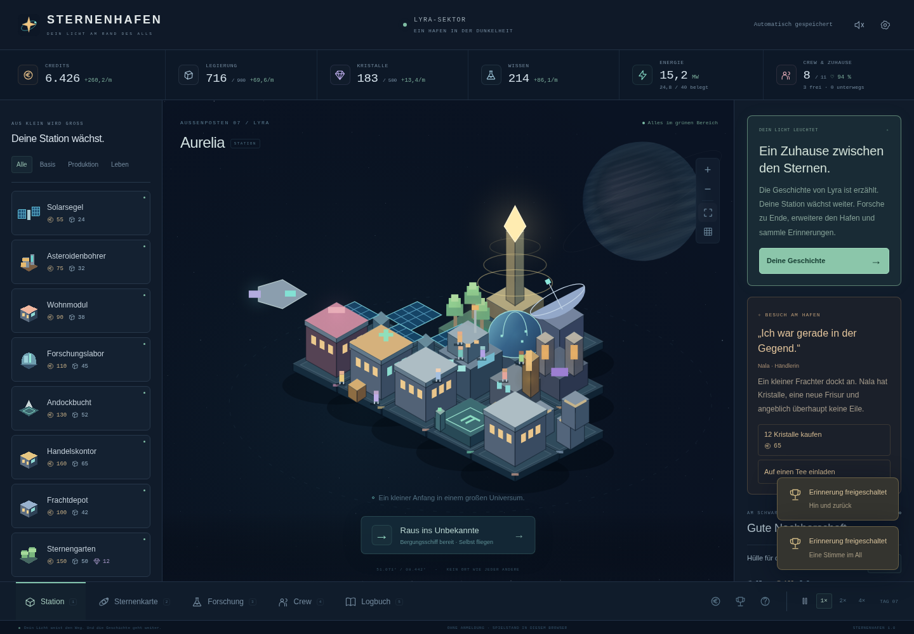

# Sternenhafen

**Dein Licht am Rand des Alls.** Ein vollständiges kleines Browser-Aufbauspiel: Aus einem Außenposten mit zwei Modulen wird ein lebendiger Hafen im Lyra-Sektor.

[Im Browser spielen](https://der-programmer1.github.io/sternenhafen/) · [HTML-Version als ZIP herunterladen](https://der-programmer1.github.io/sternenhafen/downloads/Sternenhafen-HTML.zip)



## Spielen

Die Kampagne führt durch elf Kapitel bis zum Lyra-Leuchtfeuer. Danach kann die Station weiterwachsen. Eine simulierte Kampagne mit regulären Baukosten und Produktion erreicht das Ziel in etwa 24 Minuten Spielzeit bei 1×; Entscheidungen und eigene Bergungsflüge kommen dazu. Das Tempo ist jederzeit auf 2× oder 4× umstellbar.

- 13 Modultypen einschließlich Zentrale, Solarsegel, Labor, Sternengarten und Leuchtfeuer; Ausbauten bis Stufe 3.
- Crew mit Spezialgebieten, Arbeitsplätzen, Stimmung und Erfahrung.
- Elf Technologien und fünf Expeditionsziele mit drei garantierten, einmaligen Signalfragmenten.
- Acht Besucherbegegnungen, Lieferaufträge, zwölf Erinnerungen und ein fortlaufendes Logbuch.
- Ein steuerbarer Bergungsflug mit Bordlaser, Frachtketten, Asteroiden, Reparaturfunden und einer eigenen Bestleistung.
- Eine Freundesrangliste mit Stationspunkten, fünf Wertungsansichten, teilbaren Stationsprofilen und direktem Vergleich zweier Häfen.
- Automatisches Speichern, Wiederherstellung des vorherigen Standes, JSON-Import und -Export sowie bis zu 30 Minuten Offline-Fortschritt.
- Maus, Tastatur und Touch; optionale, im Browser erzeugte Synth-Klänge. Keine Anmeldung oder Käufe.

Der Spielstand liegt nur in diesem Browser. Exportiere ihn unter **Einstellungen**, bevor du Browserdaten löschst oder das Gerät wechselst. Ein pausierter Spielstand produziert auch offline nicht weiter.

### Mit Freunden vergleichen

Öffne unten **Rangliste** (Tastatur: `6`) und kopiere deinen Stationslink. Wer ihn öffnet, sieht deinen geteilten Stand und kann ihn in seiner Freundesrangliste merken. Mit einem Antwortlink lassen sich beide Stationen direkt nebeneinander vergleichen. Alternativ lässt sich ein Stationslink im Ranglistenfenster einfügen.

Die Gesamtwertung setzt sich aus Stationsbau, Forschung, Entdeckungen und der besten Bergung zusammen. Die genaue Berechnung steht im Spiel. Gleichstände teilen sich den Rang. Ein neuer Link derselben Station aktualisiert den vorhandenen Eintrag, auch nach einer Umbenennung; ältere Links ersetzen keinen neueren Stand.

Die Rangliste besteht aus den Momentaufnahmen, die du selbst hinzufügst. Deine eigene Station wird aktuell angezeigt. Die Vergleichsliste bleibt in diesem Browser; Stationslinks können erneut hinzugefügt werden. Der Link enthält nur Stationsname, Kennung und Vergleichswerte. Deine vollständige Speicherdatei wird nicht geteilt. Bestehende Spielstände erhalten ihre Stationskennung beim Laden, ohne ihren Fortschritt zurückzusetzen.

### Eine Datei, ohne Einrichtung

Die zusätzlich erzeugte Datei `release/Sternenhafen.html` enthält das gesamte Spiel und lässt sich direkt in einem aktuellen Browser öffnen. Sie benötigt keine Netzwerkverbindung. Für den Wechsel zur GitHub-Pages-Version zuerst den Spielstand exportieren und dort importieren: lokale Dateien und Websites haben getrennte Browserspeicher.

### Lokal aus dem Quellcode

Voraussetzung: Node.js 20 oder neuer. Das Spiel und der normale Build benötigen keine Laufzeitpakete.

```sh
npm run dev
```

Dann `http://127.0.0.1:4173` öffnen. Einen anderen Port kannst du mit `PORT=4200 npm run dev` wählen. Wegen der JavaScript-Module den Quellcode über HTTP öffnen, nicht `index.html` direkt doppelklicken.

## Steuerung

| Aktion | Bedienung |
| --- | --- |
| Modul bauen | Baumenü → Modul → markiertes Nachbarfeld |
| Bauen per Tastatur | Modul wählen → Pfeiltasten → Eingabe |
| Modul ausbauen / Crew zuweisen | Gebautes Modul anklicken |
| Ansicht verschieben / zoomen | Ziehen / Mausrad oder Ansichtstasten |
| Station / Karte / Forschung / Crew / Logbuch | `1` / `2` / `3` / `4` / `5` |
| Freundesrangliste und Stationsvergleich | `6` |
| Baumenü | `B` |
| Pause | Leertaste außerhalb von Eingabefeldern |
| Abbrechen / Fenster schließen | `Esc` |
| Bergungsschiff | WASD, Pfeiltasten oder Finger; Laser automatisch |

Produktionsmodule brauchen je eine Person. Neue Wohnplätze stellen noch keine Crew ein: Das geschieht im Crew-Fenster. Energieknappheit bremst die Produktion. Zentrale, Handel und Bergung verhindern Sackgassen bei fehlendem Material. Expeditionen verlieren niemals Crew, auch bei Zwischenfällen.

## Auf GitHub Pages veröffentlichen

Das Spiel ist statisch und funktioniert auch unter einem Repository-Unterpfad. Keine Domain, API-Schlüssel, Datenbank oder Backend-Kosten erforderlich.

1. Den Quellcode auf den Standardbranch `main` pushen.
2. Im Repository **Settings → Pages → Build and deployment** öffnen.
3. Als Source **GitHub Actions** auswählen.
4. Der Workflow `Publish Sternenhafen` prüft das Spiel, baut Website und Einzeldatei und veröffentlicht die Ausgabe auf GitHub Pages. Nach jedem weiteren Push auf `main` läuft er erneut.

Die Datei `.nojekyll` ist enthalten. Alternativ erzeugt `npm run build` ein sauberes Verzeichnis `dist/`, das auf jedem gewöhnlichen statischen Webhost bereitgestellt werden kann. Serverfunktionen sind nicht erforderlich. Die Pages-Ausgabe enthält unter `downloads/` zusätzlich die Einzeldatei als HTML und ZIP.

## Prüfen und bauen

```sh
npm test
npm run build
```

46 automatisierte Tests prüfen unter anderem Ressourcen, Bauverbindungen, Personal, Forschungsabhängigkeiten, Fragment-Vergabe, Recycling, Pausen, Offline-Fortschritt, Datei-Validierung, die erreichbare Kampagne sowie Punktberechnung, geteilte Profile, Gleichstände und Spielstand-Migration.

Für die Browser-Prüfung zusätzlich Playwright installieren und den lokalen Server starten:

```sh
npm install --no-save playwright
npx playwright install chromium
npm run dev
# In einem zweiten Terminal:
npm run test:browser
```

Ein vorhandenes Chromium lässt sich mit `CHROMIUM_PATH=/usr/bin/chromium npm run test:browser` verwenden. Ein abweichendes Testziel mit `TEST_BASE_URL=http://127.0.0.1:4200` angeben.

Der Browser-Test spielt den Einstieg bis zum zurückkehrenden ersten Expeditionsschiff, prüft einen Bergungsflug, Dateiexport/-import, Neuladen, alle neun Fenster sowie echten Touch-Bau auf einem 390 × 844 großen Display. Screenshots landen in `test-results/`.

`npm run test:social-browser` prüft zusätzlich den Austausch zweier unabhängiger Browser-Sitzungen: Kopieren und Öffnen eines Links, Rangliste, Vergleich, Aktualisierung, Schutz vor Duplikaten, Wiederherstellung, unlesbare Links und Namen mit HTML-Zeichen. Auch die mobile Ansicht und die manuelle Alternative bei gesperrter Zwischenablage werden geprüft.

Für die Einzeldatei den festgeschriebenen Entwicklungs-Builder installieren:

```sh
npm ci
npm run build:standalone
```

## Aufbau

| Datei | Aufgabe |
| --- | --- |
| `src/engine.mjs` | Reine Spielsimulation, Ökonomie und validierte Spielstände |
| `src/content.mjs` | Module, Crew, Kapitel, Forschung, Begegnungen und Sektoren |
| `src/art.mjs` | Isometrische Grafik, Kamera, Touch- und Maussteuerung |
| `src/salvage.mjs` | Eigenständiger Bergungsflug |
| `src/audio.mjs` | Synthesizer und optionale Atmosphäre |
| `src/social.mjs` | Vergleichsprofile, Punkte, Linkformat und Rangfolge |
| `src/social-ui.mjs` | Teilen, Freundesrangliste und Vergleichsansicht |
| `src/app.mjs` | Oberfläche, Eingaben, Speichern und Übergänge |

Alle Spielgrafiken und Klänge werden lokal erzeugt. Es werden keine fremden Bild-, Schrift- oder Musikdienste geladen. Im öffentlichen Repository stehen nur Spielcode und Spielinhalte; persönliche Spielstände gehören nicht ins Repository.
